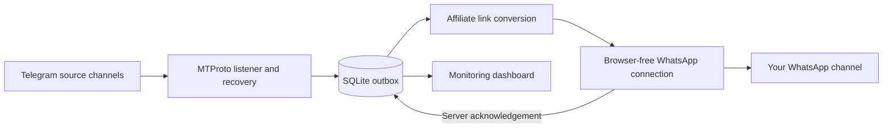

# Telegram → WhatsApp Affiliate Relay

[](https://github.com/Lost-Alien/Telegram-WhatsApp-Affiliate-Relay/actions/workflows/ci.yml)


Turn Telegram channel posts into affiliate deals and publish them to a WhatsApp channel. One Node.js process handles both connections, link conversion and a persistent delivery queue. **No Chromium or Puppeteer required.**

Configure your own source channels, destination newsletter JID and affiliate accounts. This public edition contains no production credentials, account sessions, channel identifiers or server deployment details.

## What it does

- **Receives posts as they arrive** using Telegram MTProto updates, with a recovery pass for missed messages.
- **Rewrites Amazon links** with your store tag, including supported short URLs and hidden Telegram text links.
- **Converts Flipkart and supported merchants** through your Cuelinks channel while retaining product and variant identifiers.
- **Preserves deal content**: plain text, prices, coupons, captions, photos and videos within the configured media bound.
- **Keeps an outbox on disk** so queued posts survive process restarts and temporary disconnections.
- **Avoids duplicate queue entries** using Telegram channel/message IDs and stable WhatsApp message IDs.
- **Shows a password-free monitor** with connection status, pairing QR codes, delivery counts, errors and process RAM.
- **Bounds resource use** with one delivery worker, two concurrent URL conversions and an optional systemd memory limit.

There is no hourly posting cap or deliberate delay between healthy deliveries. Short-link resolution, media transfer, network latency and platform responses determine actual delivery time.

## How it works



## Requirements

- **Node.js 22.13 or later**, including the built-in `node:sqlite` module.
- A Telegram API ID and hash from [my.telegram.org](https://my.telegram.org).
- A Telegram account allowed to read your source broadcast channels.
- A WhatsApp account that administers the destination channel, plus its `@newsletter` JID.
- Your Amazon Associates store tag. Add your Cuelinks channel ID for Flipkart and other supported merchant conversions.

WhatsApp connects through [Baileys](https://github.com/WhiskeySockets/Baileys), an unofficial WhatsApp Web library. This project does not use the official WhatsApp Cloud API. Protocol changes can require dependency updates.

## Quick start

```sh
git clone https://github.com/Lost-Alien/Telegram-WhatsApp-Affiliate-Relay.git
cd Telegram-WhatsApp-Affiliate-Relay
npm ci
cp .env.example .env
```

On PowerShell, use `Copy-Item .env.example .env` for the last step. Edit `.env` and fill in your own values:

```dotenv
TELEGRAM_API_ID=<your-telegram-api-id>
TELEGRAM_API_HASH=<your-telegram-api-hash>
TELEGRAM_SOURCE_CHANNELS=@your_deals_channel,@another_source
WHATSAPP_TARGET_JID=<your-channel-id>@newsletter
AMAZON_AFFILIATE_TAG=<your-amazon-store-tag>
CUELINKS_CHANNEL_ID=<your-cuelinks-channel-id>
```

The angle-bracket values above are placeholders. Leave `CUELINKS_CHANNEL_ID` blank for Amazon-only use. Then run:

```sh
npm run check
npm test
npm start
```

Open **[localhost:3100](http://localhost:3100/)**:

1. Scan the Telegram QR in **Telegram → Settings → Devices → Link Desktop Device**.
2. Scan the WhatsApp QR in **WhatsApp → Linked devices** using the channel administrator's account.
3. Wait for both connections to show **connected**. New source posts will enter the outbox automatically.

Sessions are saved in `.data/relay.sqlite`. A normal restart reconnects without another scan. The relay uses its own sessions and does not need an existing Telegram or WhatsApp bot.

## Configuration

| Variable | Purpose | Default |
| --- | --- | --- |
| `TELEGRAM_API_ID` / `TELEGRAM_API_HASH` | Telegram application credentials | Empty; supply your own |
| `TELEGRAM_SOURCE_CHANNELS` | Comma-separated broadcast channels | Empty; never means all chats |
| `WHATSAPP_TARGET_JID` | Your destination channel's `@newsletter` JID | Required |
| `AMAZON_AFFILIATE_TAG` | Your Amazon Associates store tag | Required |
| `AMAZON_DOMAIN` | Marketplace used for canonical product links | `amazon.in` |
| `CUELINKS_CHANNEL_ID` | Your tracking channel for supported merchants | Empty; required for non-Amazon affiliate conversions |
| `CUELINKS_API_KEY` | Optional API key for merchant short URLs | Empty; direct tracking URLs are used without it |
| `CUELINKS_SUBID` | Tracking label attached to Cuelinks conversions | `tgwarelay` |
| `FOOTER_URL` | Optional invitation URL appended to posts | Empty |
| `HOST` / `PORT` | Dashboard listen address and port | `127.0.0.1` / `3100` |
| `DATA_DIR` | SQLite database and temporary media folder | `.data` |
| `MAX_MEDIA_MIB` | Media download bound | `8` |
| `MAX_QUEUED_POSTS` | Maximum pending and failed outbox entries | `1000` |
| `LOG_LEVEL` | Application log verbosity | `info` |

Source formats: public `@username`, `https://t.me/username`, or a joined `-100…` channel ID resolvable by the logged-in account. Sources must be broadcast channels. The relay joins public sources when necessary to receive pushed updates.

The monitor has no login gate. Keep the default loopback address for local use; choose `HOST=0.0.0.0` when you intend to make it reachable over your network. Pairing QR codes are visible on the monitor while an account is being linked.

## Delivery and recovery

On the first activation of a source, the relay records its latest message and waits for new posts. It does not dump the channel's old history into WhatsApp.

After that, pushed updates enqueue posts immediately. A recovery pass runs every 30 seconds and reads at most 100 messages per source per pass. Cursors advance only after a message has been accepted or handled. If the outbox is full, the cursor stays in place for a later retry.

Delivery is recorded only after a matching WhatsApp server acknowledgement. Failures retry with backoff; after eight unsuccessful attempts, the post remains visible as failed. A disconnected account leaves work queued without consuming attempts. Sent/skipped deduplication records are retained for 30 days.

**Delivery is at least once.** A crash after WhatsApp accepts a post but before local state is saved can still cause a duplicate, despite stable message IDs. A server acknowledgement confirms acceptance by WhatsApp, not that every subscriber has viewed the post.

To retry failed entries, stop the relay, run `node scripts/retry-failed.js` with the same `.env`, and restart it.

## Monitoring and deployment

| Route | Result |
| --- | --- |
| `/` | Connection and delivery dashboard |
| `/api/status` | Connection state, queue totals, recent outcomes and RAM |
| `/healthz` | HTTP `200` when both connections are ready; otherwise `503` |

The provided [systemd service](deploy/telegram-whatsapp-relay.service) uses a 112 MiB JavaScript heap, 160 MiB soft / 192 MiB hard service RAM limit, 128 MiB swap limit and half a CPU core. These are starting limits, not a guarantee for every account or workload. [Deployment instructions](docs/DEPLOYMENT.md) cover the generic service account, paths, startup and backups.

## Project layout

```text
src/
  main.js          Startup, wiring and shutdown
  config.js        Environment configuration and validation
  telegram.js      Source subscriptions, recovery and media downloads
  affiliate.js     URL expansion and affiliate conversion
  whatsapp.js      WhatsApp connection, SQLite auth and acknowledgements
  store.js         Outbox, cursors and account-state persistence
  relay.js         Single delivery worker and retry handling
  dashboard.js     Monitoring HTTP routes
public/            Dashboard page
scripts/           Syntax checks and manual maintenance commands
tests/             Offline unit and integration tests
deploy/            Generic systemd unit
docs/              Architecture and deployment notes
```

See [architecture notes](docs/ARCHITECTURE.md) for the data flow and recovery boundaries, and [CONTRIBUTING.md](CONTRIBUTING.md) for development checks.

## Practical limits

- Telegram formatting is rendered as plain text. Hidden link destinations are retained and converted.
- Albums are sent as individual posts. Edits and deletions are not mirrored.
- Images/videos above the configured bound fall back to the post's text and links; unsupported attachments are not forwarded.
- Protected or expiring posts are recorded as skipped.
- Other channel invitation URLs are removed. Unknown merchant URLs are left unchanged.
- Unresolved supported affiliate short links stay queued for retry instead of retaining another account's commission tag.
- The outbox uses local disk. Losing the database loses account sessions, pending posts and recovery cursors.

## Troubleshooting

**Both accounts are connected, but nothing is sent.** First activation waits for a new source post. Check that the source is active and readable by the Telegram account.

**The health endpoint returns `503`.** One or both accounts are still pairing or reconnecting. Open the monitor for the current state.

**Telegram asks for two-step verification.** If the account already has a password, submit it locally to `POST /internal/telegram-password` as a JSON `password` field. The account password is used for that sign-in only and is not saved. This does not add a dashboard login page.

**A post remains failed.** Check its error on the monitor. Common causes include an inaccessible short URL, missing Cuelinks configuration, revoked source access or an account without destination-channel administrator rights.

**Try one recent deal manually.** With the relay stopped, run `node scripts/check-recent-deal.js`, then restart it. This command can enqueue one eligible deal from the last hour for a real delivery check; it is never run automatically.

## Tests

```sh
npm run check
npm test
```

Tests use synthetic identifiers and mocked transports. They cover affiliate replacement, short-link errors, hidden Telegram entities, conversion concurrency, durable outbox recovery, duplicate prevention, failed-job retries, binary auth persistence, acknowledgement handling, configuration isolation and the password-free dashboard. No live credentials are required.

## Built with

- [teleproto](https://github.com/sanyok12345/teleproto) for Telegram MTProto.
- [Baileys](https://github.com/WhiskeySockets/Baileys) for the browser-free WhatsApp connection.
- Node.js [SQLite](https://nodejs.org/api/sqlite.html), [Pino](https://github.com/pinojs/pino) and [node-qrcode](https://github.com/soldair/node-qrcode).

Environment files, account/session databases, QR data, CSV exports and private deployment helpers are excluded from this repository.
